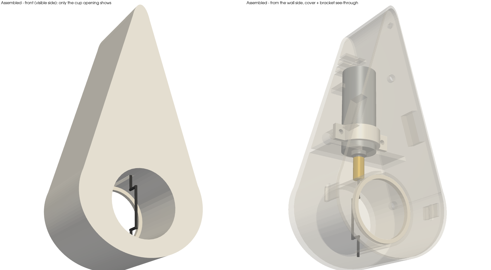
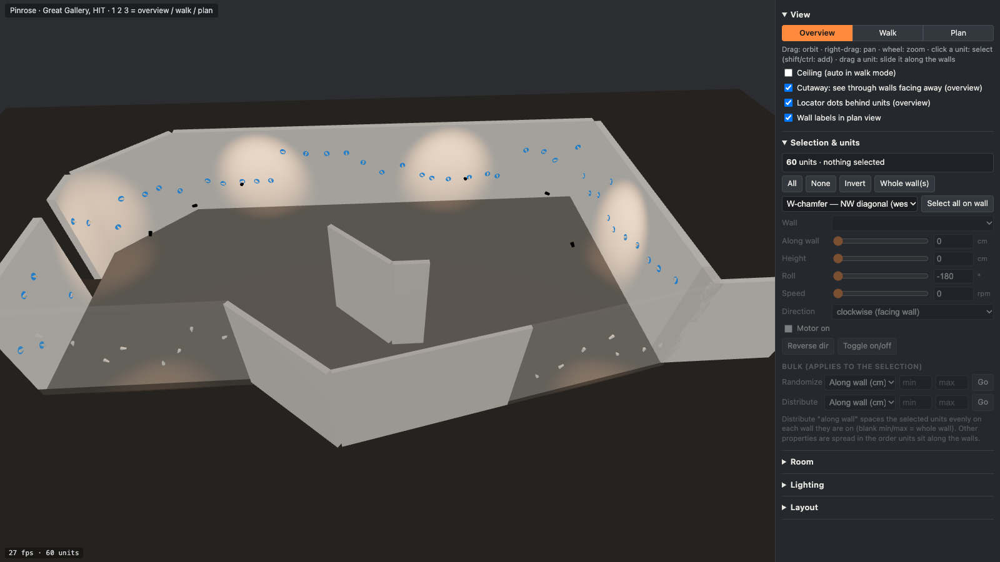

# Pinrose

**[English](#english) · [עברית](#עברית)**

---

## English

**Pinrose** is a kinetic (moving) art installation by Eily Levi, made with Studio Exmachina, for the Great Gallery
(גלריה גדולה) at HIT Holon. It is made of 60 identical teardrop-shaped units mounted on the gallery walls at
different positions, heights and angles. Inside each unit a small motor slowly turns a soft tan funnel, the
"Penrose drain", so the walls are covered with 60 funnels quietly turning.



*One unit (version 2). Left: what visitors see. Right: the same unit from the wall side, made see-through so the motor, the brass connector and the crank are visible.*

### What's in this repository

| What | What it is for | Where |
|---|---|---|
| **The printed parts, version 2 (current)** | The files a 3D-print shop needs to make one unit. Four plastic parts: the **cover** (the teardrop shell you see, which also holds the motor), the **wall bracket** (the back plate that is screwed to the wall and closes the cover from behind), the **ring** (holds the funnel in place), and a small **motor strap** (a clip that holds the motor still). Print each one 60 times. | [`cad/out/`](cad/out/): `pinrus_v2.stl` (cover), `pinruswall_v2.stl` (wall bracket), `pinruso.stl` (ring), `motor_strap_v2.stl` (strap). All four in one file: [`pinrose_v2_printables.zip`](cad/out/pinrose_v2_printables.zip) |
| **The original parts, version 1** | The first prototype, as it was before the redesign. Kept for reference. In this version the motor sat loose inside the cover. | [`3d/`](3d/): `pinrus.stl` (cover), `pinruswall.stl` (wall bracket), `pinruso.stl` (ring) |
| **The assembly file (STEP)** | The whole unit put together: shell, motor, connector, crank and ring, in a format that every engineering program opens (STEP). Give this to a workshop or fabricator who wants to see how everything fits. | [`cad/out/pinrose_v2_assembly_step.zip`](cad/out/pinrose_v2_assembly_step.zip) (unzip it to get `pinrose_v2_assembly.step`) |
| **Pictures of the design (renders)** | Computer-made pictures of version 2: assembled, taken apart, cut in half to show the inside, and the inside of the cover. | [`cad/out/`](cad/out/): `pinrose_v2_assembled.png`, `pinrose_v2_exploded.png`, `pinrose_v2_section.png`, `pinrose_v2_section_strap.png`, `pinrose_v2_cover_inside.png` |
| **The gallery simulator** | A 3D model of the gallery that runs in a web browser. You can walk through the room, arrange all 60 units, change their speed, light the space and save the arrangement. See "How to run the simulator" below. | [`sim/`](sim/) (screenshots in [`sim/docs/`](sim/docs/)) |
| **The installation sheet (CSV)** | A table the simulator creates from your arrangement, one line per unit, that the installation team can follow on site. It opens in Excel, Numbers or Google Sheets. | Made by the simulator's **Export CSV** button (it is not stored in the repository; it is downloaded to your computer) |
| **Photos, videos and floor plans** | Photos and videos of the prototype, photos of the motor inside it, and the gallery floor plans (`gallery2.jpeg` has the walls for the units marked in blue). | [`media/`](media/) |

Hardware per unit (to buy, not print): 2 small M3 screws and 2 brass threaded inserts for the motor strap, and 2 wall screws with wall plugs.



*The gallery simulator, overview mode. The blue dots mark the units, and the panel on the right controls them.*

### How to run the simulator

**Is there a version you can just open?** Not yet. Double-clicking the simulator's files does not work, because
browsers block it. Someone who already has it running (step 5 below) can type `npm run build`; this makes a
ready-made folder, `sim/dist`, that can be put on any website host and then shared as a simple link that needs
no installation. Until that is done, follow these steps once:

1. **Install Node.js** (the free program that runs the simulator on your computer). Download the "LTS" version
   from **<https://nodejs.org/>** and install it like any other program.
2. **Download this repository.** On this GitHub page, click the green **Code** button, then **Download ZIP**.
   Unzip the file. You get a folder called `eily-levi-pinrose-main`. (The repository is private, so you need to be
   signed in to a GitHub account that has access.)
   *If you use git:* `git clone https://github.com/zvikapika/eily-levi-pinrose.git` instead.
3. **Open a terminal** (a window where you type commands):
   - Mac: press `Cmd`+`Space`, type `Terminal`, press `Enter`.
   - Windows: open the Start menu, type `PowerShell`, press `Enter`.
4. **Go into the simulator folder.** Type `cd ` (with a space after it), then drag the `sim` folder (inside
   `eily-levi-pinrose-main`) into the terminal window, and press `Enter`.
5. **Start the simulator.** Type these two commands, pressing `Enter` after each one:

   ```bash
   npm install
   npm run dev
   ```

   The first one downloads what the simulator needs. It runs only the first time and takes a minute or two.
   The second one starts the simulator. Leave the terminal window open while you use it.
   (If you are not inside the `sim` folder, start with `cd sim`.)
6. **Open the simulator** in Chrome, Edge or Safari at **<http://127.0.0.1:5178>**.
7. **To stop**, close the terminal window (or press `Ctrl`+`C` in it). Next time, repeat only steps 3, 4 and
   the `npm run dev` command, then step 6.

### Using the simulator

Everything is in the panel on the right. Its parts are **View**, **Selection & units**, **Room**, **Lighting**
and **Layout**; click a title to open it.

- **Three ways to look at the room** (buttons at the top of the panel, or keys `1` `2` `3`):
  - **Overview** (`1`): the room from above, like a model on a table. Drag to turn it, right-drag to move it,
    scroll to zoom in and out. Walls facing away from you become see-through.
  - **Walk** (`2`): see the room at eye height (160 cm). Click the view, then walk with `W` `A` `S` `D` or the
    arrow keys and look around with the mouse. Hold `Shift` to walk faster. Press `Esc` to get the mouse back.
  - **Plan** (`3`): a flat top-down plan, oriented like the floor plan drawing. Blue walls get units, orange is
    the optional corridor wall, grey walls get none.
- **Choosing units:** click a unit to choose it. Hold `Shift` (or `Ctrl`/`Cmd`) and click to add or remove more.
  In **Plan**, drag a box on the floor to choose all the units inside it. The **All / None / Invert** buttons,
  and **Select all on wall** (pick a wall from the list first), choose many at once.
- **Moving units:** drag a unit to slide it along the wall. It can go around a corner onto the next wall.
- **Changing units:** whatever you set in **Selection & units** applies to every chosen unit: which wall, how far
  along it (**Along wall**), **Height**, **Roll** (the angle of the teardrop on the wall; 0° = tip pointing up),
  **Speed** (turns per minute), **Direction** (clockwise or counter-clockwise), and **Motor on**.
  **Randomize** gives the chosen units random values within a range you type in. **Distribute** spreads them
  evenly.
- **Lighting:** overall brightness (**Ambient**, **Exposure**), shadows on/off, wall and floor colour, and 6
  ceiling spotlights. Each spotlight can be turned on or off, moved and aimed, and you can set its brightness,
  colour (warm to cool) and beam width.
- **Room:** wall height (an estimate, 350 cm), and whether the corridor wall may get units.
- **Saving and loading an arrangement (Layout):**
  - Every change is saved automatically in your browser. **Restore autosave** brings it back.
  - **Save (browser)** / **Load (browser)** keep one arrangement in this browser on this computer.
  - **Download JSON** saves the arrangement as a file you can keep or email. **Upload JSON** opens such a file.
  - **Generate** makes a new random arrangement (change the **Seed** number to get a different one).
  - **Export CSV** downloads the installation sheet: for each unit, its number, its wall, the distance along
    the wall and the height in cm, its angle, speed, direction and whether it is on.

The simulator shows the units with the look of the original (version 1) parts; the outside shape of version 2
is the same.

### Still to confirm

These are guesses for now. They are written into the files as settings that are easy to change:

- **The room:** whether the slanted south wall is glass (if so, no units can go there); whether the corridor wall
  should get units; where exactly the door in the west wall is; the length of the south wall next to the storage
  room; the angle of the north-west corner; and the real wall height (350 cm is a guess).
- **The motor and speed:** how fast the motor really turns (the simulator uses 2–10 turns per minute), and the size of
  the motor's shaft and front.
- **The unit (version 2 has not been printed or tested yet):** the size of the brass connector and the crank
  wire; whether the funnel still reaches the crank; what holds the ring in place; whether the click-on cover is
  enough or screws are wanted; and the thickness of the motor's power cable.
- **The funnel's shape and wobble** in the simulator are copied by eye from the photos, not measured.

**Technical details:** simulator: [`sim/README.md`](sim/README.md) · parts and design decisions:
[`cad/README.md`](cad/README.md)

---

<div dir="rtl">

## עברית

**פינרוז** (Pinrose) היא מיצב קינטי (מיצב שזז) של האמנית אילי לוי, שנבנה עם Studio Exmachina עבור הגלריה הגדולה
במכון הטכנולוגי חולון (HIT). המיצב בנוי מ־60 יחידות זהות בצורת טיפה, שתלויות על קירות הגלריה במקומות, בגבהים
ובזוויות שונים. בתוך כל יחידה מנוע קטן מסובב לאט משפך רך בצבע בז' – "הניקוז של פנרוז" – כך שעל הקירות מסתובבים
בשקט 60 משפכים.


*יחידה אחת (גרסה 2). משמאל: מה שהמבקרים רואים. מימין: אותה יחידה מצד הקיר, שקופה, כך שרואים את המנוע, המחבר מפליז
ואת הארכובה (הזרוע המכופפת שמסובבת את המשפך).*

### מה יש במאגר

| מה | למה זה משמש | איפה |
|---|---|---|
| **החלקים להדפסה, גרסה 2 (הנוכחית)** | הקבצים שבית דפוס תלת־ממד צריך כדי לייצר יחידה אחת. ארבעה חלקי פלסטיק: **המכסה** (מעטפת הטיפה שרואים, שגם מחזיקה את המנוע), **התושבת לקיר** (הלוח האחורי שמוברג לקיר וסוגר את המכסה מאחור), **הטבעת** (מחזיקה את המשפך במקומו), ו**רצועת מנוע** קטנה (תפס שמחזיק את המנוע יציב). מדפיסים כל אחד מהם 60 פעם. | בתיקייה [`cad/out/`](cad/out/): ‏`pinrus_v2.stl` (מכסה), `pinruswall_v2.stl` (תושבת לקיר), `pinruso.stl` (טבעת), `motor_strap_v2.stl` (רצועה). כל הארבעה בקובץ אחד: [`pinrose_v2_printables.zip`](cad/out/pinrose_v2_printables.zip) |
| **החלקים המקוריים, גרסה 1** | אב הטיפוס הראשון, כפי שהיה לפני התכנון מחדש. נשמר לעיון. בגרסה הזו המנוע פשוט שכב חופשי בתוך המכסה. | בתיקייה [`3d/`](3d/): ‏`pinrus.stl` (מכסה), `pinruswall.stl` (תושבת לקיר), `pinruso.stl` (טבעת) |
| **קובץ ההרכבה (STEP)** | היחידה כולה מורכבת: מעטפת, מנוע, מחבר, ארכובה וטבעת, בפורמט שכל תוכנה הנדסית פותחת (STEP). זה הקובץ לתת לבית מלאכה או ליצרן שרוצה לראות איך הכול מתחבר. | הקובץ [`cad/out/pinrose_v2_assembly_step.zip`](cad/out/pinrose_v2_assembly_step.zip) (פותחים את ה־ZIP ובתוכו `pinrose_v2_assembly.step`) |
| **תמונות של התכנון (הדמיות)** | תמונות ממוחשבות של גרסה 2: מורכבת, מפורקת לחלקים, חתוכה לשניים כדי לראות מבפנים, ופנים המכסה. | בתיקייה [`cad/out/`](cad/out/): ‏`pinrose_v2_assembled.png`, `pinrose_v2_exploded.png`, `pinrose_v2_section.png`, `pinrose_v2_section_strap.png`, `pinrose_v2_cover_inside.png` |
| **סימולטור הגלריה** | מודל תלת־ממדי של הגלריה שרץ בדפדפן. אפשר להסתובב בחדר, לסדר את כל 60 היחידות, לשנות את המהירות שלהן, להאיר את החלל ולשמור את הסידור. ההסבר בהמשך, ב"איך מפעילים את הסימולטור". | בתיקייה [`sim/`](sim/) (צילומי מסך ב־[`sim/docs/`](sim/docs/)) |
| **דף ההתקנה (CSV)** | טבלה שהסימולטור מפיק מהסידור שבחרתם, שורה לכל יחידה, שצוות ההתקנה יכול לעבוד לפיה בגלריה. נפתחת ב־Excel, ב־Numbers או ב־Google Sheets. | נוצרת בכפתור **Export CSV** בסימולטור (היא לא שמורה במאגר, אלא יורדת למחשב שלכם) |
| **תמונות, סרטונים ותוכניות הגלריה** | תמונות וסרטונים של אב הטיפוס, תמונות של המנוע בתוכו, ותוכניות הקומה של הגלריה (ב־`gallery2.jpeg` הקירות שמיועדים ליחידות מסומנים בכחול). | בתיקייה [`media/`](media/) |

חומרה לכל יחידה (לקנות, לא להדפיס): 2 ברגי M3 קטנים ו־2 תותבות הברגה מפליז בשביל רצועת המנוע, ו־2 ברגים לקיר עם
דיבלים.


*סימולטור הגלריה, מצב מבט־על. הנקודות הכחולות הן היחידות, ובלוח שבצד ימין שולטים בהן.*

### איך מפעילים את הסימולטור

**יש גרסה שאפשר פשוט לפתוח?** עדיין לא. לחיצה כפולה על קובצי הסימולטור לא עובדת, כי הדפדפן חוסם אותה. מי שכבר
מריץ את הסימולטור (שלב 5 בהמשך) יכול להקליד `npm run build`. הפקודה הזו מכינה תיקייה מוכנה, `sim/dist`, שאפשר להעלות
לכל שירות אחסון אתרים ואז לשלוח קישור רגיל שלא דורש שום התקנה. עד שזה יקרה, עוברים פעם אחת על השלבים האלה:

<ol dir="rtl">
<li>

**מתקינים את Node.js** (תוכנה חינמית שמריצה את הסימולטור במחשב). מורידים את גרסת ה־LTS מ־**<https://nodejs.org/>**
ומתקינים כמו כל תוכנה אחרת.

</li>
<li>

**מורידים את המאגר.** בעמוד הזה ב־GitHub לוחצים על הכפתור הירוק **Code** ואז **Download ZIP**, ופותחים את
קובץ ה־ZIP. מתקבלת תיקייה בשם `eily-levi-pinrose-main`. (המאגר פרטי, ולכן צריך להיות מחוברים לחשבון GitHub שיש
לו גישה.)

*למי שעובד עם git:* אפשר במקום זה `git clone https://github.com/zvikapika/eily-levi-pinrose.git`.

</li>
<li>

**פותחים טרמינל** (חלון שבו מקלידים פקודות):

- במק: לוחצים `Cmd+Space`, מקלידים `Terminal` ולוחצים `Enter`.
- בווינדוס: פותחים את תפריט התחל, מקלידים `PowerShell` ולוחצים `Enter`.

</li>
<li>

**נכנסים לתיקיית הסימולטור.** מקלידים `cd ` (עם רווח אחריו), גוררים לחלון הטרמינל את התיקייה `sim` (שנמצאת בתוך
`eily-levi-pinrose-main`) ולוחצים `Enter`.

</li>
<li>

**מפעילים את הסימולטור.** מקלידים את שתי הפקודות האלה, ולוחצים `Enter` אחרי כל אחת:

<div dir="ltr">

```bash
npm install
npm run dev
```

</div>

הראשונה מורידה את מה שהסימולטור צריך. צריך אותה רק בפעם הראשונה, והיא לוקחת דקה־שתיים. השנייה מפעילה את
הסימולטור. משאירים את חלון הטרמינל פתוח כל זמן שעובדים. (אם אתם לא בתוך התיקייה `sim`, מתחילים ב־`cd sim`.)

</li>
<li>

**פותחים את הסימולטור** ב־Chrome, ב־Edge או ב־Safari, בכתובת **<http://127.0.0.1:5178>**.

</li>
<li>

**כדי לעצור** סוגרים את חלון הטרמינל (או לוחצים בו `Ctrl+C`). בפעם הבאה חוזרים רק על שלבים 3 ו־4 ועל הפקודה
`npm run dev`, ואז על שלב 6.

</li>
</ol>

### עבודה עם הסימולטור

הכול נמצא בלוח שבצד ימין. החלקים שלו הם **View** (תצוגה), **Selection & units** (בחירה ויחידות), **Room** (החדר),
**Lighting** (תאורה) ו־**Layout** (סידור). לוחצים על כותרת כדי לפתוח אותה.

- **שלוש דרכים להסתכל על החדר** (הכפתורים בראש הלוח, או המקשים `1` `2` `3`):
  - מבט־על – **Overview** (`1`): החדר מלמעלה, כמו דגם על שולחן. גוררים כדי לסובב, גוררים עם הכפתור הימני כדי
    להזיז, וגלגלת העכבר מקרבת ומרחיקה. קירות שפונים הרחק מכם נעשים שקופים.
  - הליכה – **Walk** (`2`): רואים את החדר בגובה העיניים (160 ס"מ). לוחצים על התמונה, הולכים עם המקשים `WASD`
    או עם החיצים ומסתכלים מסביב עם העכבר. `Shift` מאיץ את ההליכה, ו־`Esc` מחזיר את העכבר.
  - תוכנית – **Plan** (`3`): תוכנית שטוחה מלמעלה, בכיוון של שרטוט הגלריה. בקירות הכחולים יש יחידות, הכתום הוא קיר
    המסדרון (אופציונלי), ובקירות האפורים אין יחידות.
- **בחירת יחידות:** לוחצים על יחידה כדי לבחור אותה. עם `Shift` (או `Ctrl`/`Cmd`) לחוץ מוסיפים או מורידים עוד
  יחידות. במצב **Plan** גוררים מלבן על הרצפה ובוחרים את כל היחידות שבתוכו. הכפתורים **All / None / Invert** (הכול /
  כלום / היפוך), ו־**Select all on wall** (קודם בוחרים קיר מהרשימה), בוחרים הרבה יחידות בבת אחת.
- **הזזת יחידות:** גוררים יחידה כדי להחליק אותה לאורך הקיר. היא יכולה גם לעבור פינה אל הקיר הבא.
- **שינוי יחידות:** מה שמגדירים ב־**Selection & units** חל על כל היחידות שנבחרו: על איזה קיר, כמה רחוק לאורכו
  (**Along wall**), גובה (**Height**), זווית הטיפה על הקיר (**Roll**; 0° = החוד למעלה), מהירות בסיבובים לדקה
  (**Speed**), כיוון – עם או נגד כיוון השעון (**Direction**), ומנוע פועל או כבוי (**Motor on**). **Randomize** נותן
  ליחידות שנבחרו ערכים אקראיים בטווח שאתם מקלידים, ו־**Distribute** מפזר אותן במרווחים שווים.
- **תאורה (Lighting):** בהירות כללית (**Ambient**, **Exposure**), צללים, צבע הקירות והרצפה, ו־6 פנסים בתקרה. כל פנס
  אפשר להדליק ולכבות, להזיז ולכוון, ולקבוע לו עוצמה, גוון (מחם לקר) ורוחב אלומה.
- **החדר (Room):** גובה הקירות (הערכה, 350 ס"מ), והאם מותר לשים יחידות על קיר המסדרון.
- **שמירה ופתיחה של סידור (Layout):**
  - כל שינוי נשמר אוטומטית בדפדפן, ו־**Restore autosave** מחזיר אותו.
  - שמירה בדפדפן: **Save (browser)** / **Load (browser)** שומרים ופותחים סידור אחד בדפדפן הזה, במחשב הזה.
  - שמירה כקובץ: **Download JSON** שומר את הסידור כקובץ שאפשר לשמור או לשלוח במייל, ו־**Upload JSON** פותח קובץ כזה.
  - סידור חדש: **Generate** יוצר סידור אקראי חדש (משנים את המספר ב־**Seed** כדי לקבל סידור אחר).
  - דף ההתקנה: **Export CSV** מוריד אותו – לכל יחידה המספר שלה, הקיר, המרחק לאורך הקיר והגובה בס"מ, הזווית, המהירות,
    הכיוון והאם היא פועלת.

בסימולטור היחידות נראות כמו החלקים המקוריים (גרסה 1). הצורה החיצונית של גרסה 2 זהה.

### מה עוד צריך לאשר

אלה הערכות בינתיים. הן כתובות בקבצים כהגדרות שקל לשנות:

- **החדר:** האם הקיר הדרומי האלכסוני עשוי זכוכית (אם כן, אי אפשר לשים עליו יחידות); האם לשים יחידות על קיר המסדרון;
  איפה בדיוק נמצאת הדלת בקיר המערבי; אורך הקיר הדרומי ליד המחסן; הזווית של הפינה הצפון־מערבית; וגובה הקירות האמיתי
  (350 ס"מ הוא ניחוש).
- **המנוע והמהירות:** כמה מהר המנוע מסתובב באמת (בסימולטור 2–10 סיבובים לדקה), והמידות של ציר המנוע ושל החזית שלו.
- **היחידה (גרסה 2 עוד לא הודפסה ולא נוסתה):** מידות המחבר מפליז ותיל הארכובה; האם המשפך עדיין מגיע לארכובה; מה מחזיק
  את הטבעת במקומה; האם מספיק שהמכסה ננעל בלחיצה או שרוצים ברגים; ועובי כבל החשמל של המנוע.
- **הצורה של המשפך והנדנוד שלו** בסימולטור הועתקו בעין מהתמונות, ולא נמדדו.

**פרטים טכניים:** הסימולטור – [`sim/README.md`](sim/README.md) · החלקים והחלטות התכנון – [`cad/README.md`](cad/README.md)

</div>
