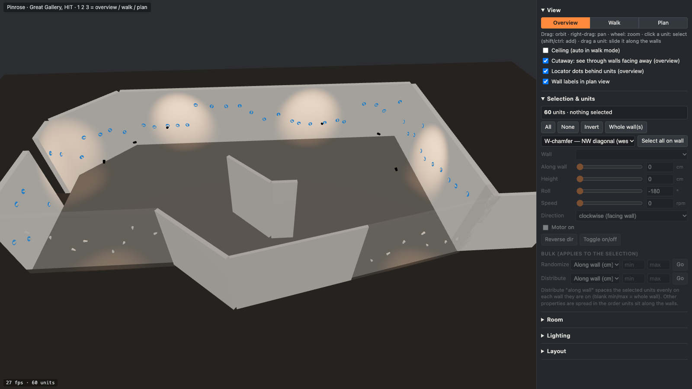

# Pinrose gallery simulator

Browser 3D simulator/configurator for **Pinrose** (Eily Levi × Studio Exmachina): the Great Gallery
(גלריה גדולה, HIT Holon) with all 60 motorised wall units. You can walk through the room, arrange the
units, light the space, and export an installation sheet. Plain Vite + Three.js, no backend.



## Run

```bash
cd sim
npm install
npm run dev            # http://127.0.0.1:5178
```

Static build: `npm run build` writes `sim/dist/` with relative paths. Put that folder on any static web server
(`npm run preview`, `npx serve dist`, GitHub Pages, …). Opening `index.html` straight from disk (`file://`) won't work, because browsers
block the GLB fetch there.

Self-test: with the dev server running, `npm run verify` drives your installed Google Chrome through 21 checks
(60 units rotating, picking, box select, bulk ops, drag, walk and collision, CSV/JSON/localStorage, lighting, toggles) and
rewrites `docs/*.png`. Use `SIM_URL=http://127.0.0.1:4173/ npm run verify` to test a preview build.

## Using it

| Mode | Keys / mouse |
|---|---|
| **Overview** (key `1`) | drag = orbit, right-drag = pan, wheel = zoom. Walls whose face points away from you are see-through ("cutaway"). Blue dots behind the units mark where they are when you're far away. |
| **Walk** (key `2`) | click the view to grab the mouse (pointer lock), WASD/arrows = walk at 160 cm eye height, shift = faster, click = select the unit under the cross, Esc = release the mouse. You can't walk through walls. |
| **Plan** (key `3`) | top-down view, oriented like the drawing (north up). Drag on empty floor = box select, shift = add to the selection. Click a dot = select, drag a dot = slide that unit along the walls. Right-drag = pan, wheel = zoom. Blue = target walls, orange = optional corridor, grey = excluded. |

* **Select**: click a unit (shift/ctrl/cmd-click to add or remove one), box select in plan view, *All / None / Invert*,
  *Whole wall(s)* (extends the selection to the walls already selected), or pick a wall and press *Select all on wall*.
  Ctrl/cmd-A selects everything.
* **Drag** a unit (overview or plan) to slide it along the mountable walls. It snaps to the nearest one, so you can move it around a corner onto the next wall. In overview, dragging also sets its height.
* **Unit panel** (sets the value on every selected unit): wall, distance along the wall, height, roll (orientation on the wall plane, 0° = tip up, counter-clockwise positive when you face the wall), speed (RPM), direction, motor on/off.
  Fields where the selected units differ show *mixed*.
* **Bulk**: *Randomize* (height / roll / rpm / along-wall / direction) within min–max, *Distribute* evenly
  (along the wall: even spacing on each wall separately, blank min/max = the whole wall; other properties are spread in wall order between min and max).
* **Lighting**: ambient level, exposure, shadows on/off, wall and floor colour, 6 ceiling track lights. Each light has on/off, position, aim point, intensity (cd), colour temperature (K), beam angle and softness.
* **Room**: wall height (default 350 cm), *corridor walls mountable* toggle, show/hide excluded walls.
* **Layout**: generate a seeded layout (seed + count), save/load in the browser (localStorage), *Restore autosave*
  (every edit autosaves), download/upload the layout as JSON, **Export CSV** for installation.

### CSV columns

`unit_id, wall_id, wall_label, distance_along_wall_cm, height_cm, orientation_deg, rpm, direction, on, plan_x_cm, plan_y_cm`

* `distance_along_wall_cm`: measured along the wall's face from the **first point** of that wall in `room.json`
  (e.g. `N-east` starts at the west/east divider and runs east; `E` starts at the north-east corner and runs south).
* `height_cm`: centre of the funnel (cup axis) above the floor.
* `orientation_deg`: roll of the teardrop tip away from vertical, counter-clockwise positive when you face the wall.
* `direction`: `cw` / `ccw` as seen when you face the wall.
* `plan_x/y_cm`: the same point in the plan frame (origin = where the west wall meets the north wall of the 68 m² section, x east, y south).

## Files

```
sim/
  room.json              room geometry (cm). Edit this to correct the plan reading.
  assets/unit.glb        the unit: bracket + cover + ring from the CAD STLs (mm -> m), ~2.6k triangles
  assets/unit.json       part bounds / triangle counts written by the build script
  tools/build_unit_glb.py  STL -> GLB assembler
  src/main.js            scene, cameras, modes, picking, dragging, box select, render loop
  src/room.js            walls / floor / plan overlay from room.json, wall math, walk collision
  src/units.js           instanced unit meshes, procedural funnel, animation
  src/lights.js          ambient + track spots, colour temperature
  src/layout.js          seeded generator, JSON / CSV
  src/ui.js              side panel
  docs/*.png             screenshots
```

### room.json

Each wall is a polyline along its **mounting face**, in cm, in the plan frame above. `side` says which side
of the direction of travel the face looks into (`right`/`left`, plan y pointing down). The wall body extends
`thickness` cm behind the face. `kind` is one of `target`, `optional` or `excluded`. `source` is `dimension` when a number
written on the plan gives the length, and `plan-estimate` when the position was read off the drawing.
After editing, reload the page (in dev mode it reloads by itself). Layout files refer to walls by `id`, so keep the ids stable.

### Swapping in v2 CAD parts

The sim loads only `assets/unit.glb` (nodes `bracket`, `cover`, `ring`, in a frame where origin = funnel axis on
the wall plane, +Y = toward the teardrop tip, +Z = out of the wall). To use new parts:

```bash
uv run --with trimesh --with numpy --with scipy --with networkx sim/tools/build_unit_glb.py \
  --bracket cad/out/<bracket>.stl --cover cad/out/<cover>.stl --ring cad/out/<ring>.stl
```

If the v2 STLs are modelled with a different origin or orientation than v1, update the few constants and
transforms at the top of `build_unit_glb.py` (`CUP`, `COVER_DEPTH`, `RING_CENTER`, `m_cover`/`m_bracket`/`m_ring`).
The sim code stays the same, because the funnel pivot is read from the ring's back face at load time. The funnel itself is
procedural (`makeFunnelGeometry` in `src/units.js`).
The current `cad/out/` v2 parts (`pinrus_v2.stl`, `pinruswall_v2.stl`, `pinruso.stl`) use the same frames as v1 and
build through the script unchanged (checked). The committed `unit.glb` is still v1 from `3d/`.
To check a new GLB, look at the close-up in docs/05-unit-closeup.png.

## Reading of the floor plan: please confirm

Source: `media/gallery.jpeg`, `media/gallery2.jpeg` (blue outline = mounting area). All plan numbers are cm.

1. **Dimensioned**: north wall 600 (west section) + 994 (east section); west section depth 860 and south run 860; east wall 811; the diagonal "240".
2. **NW chamfer**: offsets of 860 − 600 = 260 cm on x, with the same 260 assumed on y (the drawing looks like 45°).
3. **West wall door**: an opening is assumed between 400 and 490 cm from the north wall (from the drawing). The wall is split into `W-north` and `W-south`.
4. **South wall of the west section** (shared with the storage room מחסן): 610 cm, from the drawing.
5. **East wall**: only the dimensioned 811 cm is a target. The ~63 cm below it, down to the slanted wall, has a grey frame drawn on it, so it's treated as not mountable (`E-stub`).
6. **Slanted south wall** (drawn thin, looks like glazing/vitrine): from (1854, 874) to (871, 1081), from the drawing.
   The blue outline cuts down at about x = 1345, so the east part (`S-vitrine`, ~520 cm) is a target and the west part next to the entry is excluded.
   **If this is glass, units can't go there. Please confirm.**
7. **Entry wedge**: the "240" wall is modelled 240 cm long at 45° from the column on the divider at (860, 570), plus a ~1 m stub. Excluded, like the storage-room diagonal wall.
8. **Divider** between the 68 m² and 85 m² sections (dashed at x = 860): treated as open, not a wall.
9. **Corridor** (`C-corridor`, optional, off by default): the grey wall going east from the SE corner, (1854, 874) → (2200, 874), with the south face assumed to be the mounting face.
10. **Area cross-check**: west section 860×860 − ½·260² = 70.6 m² against the labelled 68 (−4%). East section to the slanted wall is 97.3 m², minus the entry wedge 13.0 = 84.3 m², against the labelled 85.
11. **Wall height**: unknown. It's a parameter, default 350 cm.

### Unit assumptions (named parameters)

* `UNIT_PARAMS` in `src/units.js`: `wobbleDeg` 7° (funnel tilt from the bent crank), `bendMm` 3, `edgeMarginCm` 15 (minimum distance of the funnel centre from wall ends, floor and ceiling), `wallGapMm` 1.5.
* The funnel profile (Ø~39 mm, sticks out ~23 mm past the cover face, drain hole Ø~9 mm) is approximated from the photos. It's not measured.
* The cover's open rim sits against the wall with the bracket inside it. The bracket STL is rotated 180° about Z so its round end matches the cover's. The ring sits inside the Ø41 cup, 0.5 mm behind the cover floor.
* The generated layout: 60 units spread along the target walls in proportion to wall length (±18 cm jitter), height 90–260 cm, roll random,
  speed 2–10 rpm (the gear-motor output speed is unknown), random direction, seed 1.

## Defaults

* **On**: shadows, 6 track lights at 3500 K, cutaway, locator dots (overview), wall labels (plan), all motors.
* **Off**: corridor walls as mounting walls, ceiling (it turns on automatically in walk mode).

## Performance

Units share geometry through `InstancedMesh` (bracket, cover, ring and funnel are 4 draw calls for all 60). Only the
funnel and ring matrices update each frame. Measured in Chrome on an M2 (Metal), 1600×900: **~4.7 ms per frame
with 6 shadow-casting spots, ~2.3 ms without** (synchronous render including GPU, `__sim.bench()` in the console).
That leaves plenty of headroom for 60 fps.

## Round 2 (Eily, 2026-11-23)
- **Glass facade:** the slanted south wall (`S-vitrine`, `S-vitrine-foyer`) is `kind: glass`. It is drawn as glass, no units go on it, and a double glass door with 2 handles (position assumed, `glassDoors` in room.json) is in the entry part. Saved layouts with units on the glass get those units moved to the nearest wall when they load.
- **Ceiling grid:** the existing 4×4 cm metal grid is drawn at the ceiling. The spacing is read off the 1:20 model (~3×3 cells per space) and is approximate (`ceilingGrid` in room.json).
- **Grid lines (white 17×17 mm profile, the electric channel):** a free line editor on every wall and on the floor (press `L` or "Draw lines"). Click to start, click to end; the line continues from that end point, so you can draw a path. Esc or clicking the same point twice stops. Shift = straight. Line ends snap to unit tips (wire exit), to other line ends and to a step grid. Click a line to edit its end points; the Delete key removes it. The default ("Default wall grid") puts a grid on every mountable wall: the ceiling-grid lines continue down the walls (gaps filled to one cell) plus a run 50 cm under the ceiling. The panel shows the total profile length per surface.
- **Units are free:** units are placed freely on the walls or on the floor (Wall = "Floor": lying, funnel up), with no snapping to lines; Eily connects them to the grid she draws. "Wall ⇄ floor" moves the selection between its wall and the floor in front of it.
- **Hide units:** units can be hidden per unit, with "Hide selected" / "Show all". Hidden units are kept in the layout file and the CSV.
- **Motors:** "All motors on/off" buttons. The funnel now has two darker seams, so the rotation is visible.
- **Partitions:** 5 × 1 m rotating partitions on the divider, plus the linkage (motor on the inner ceiling, crank-rocker, 45°–90°, never closed). See `docs/partitions-mechanism.md`. Each panel can also be set by hand (0–360°) with the mechanism off.
- **Lighting:** two lighting systems (inner / outer), each with a master switch, dimmer and common colour temperature. You can add or remove track lights per space.
- **Unit LEDs:** an LED inside each unit, for the inner space only, with colour and level.
- **Export 3D (STL):** a static snapshot of the whole space in mm, Z up, for SketchUp. SketchUp for Web imports STL only with a subscription; the free plan imports .skp only.
- **Single-file build:** `bash tools/build_single.sh` → `dist-single/pinrose_gallery_sim.html`, which opens from disk with no server.
- **One-wall view (key `4`, "One wall"):** a straight-on orthographic view of one wall, framed to fit it. The camera's near plane clips everything more than 70 cm in front of that wall, so only its units and lines show. ◀ ▶ (or `[` `]`) go to the next wall, and double-clicking a wall in the overview opens it here. Units can be dragged and lines drawn in this view, just like in the overview. `1` returns to the overview.
- **Inner space quick controls** (second panel section): turn on the LEDs inside the units and darken the inner room (its lights off + the shared fill light turned down).
- **Unit colour:** units stay white when their motor is off; the locator dots still show on/off.
