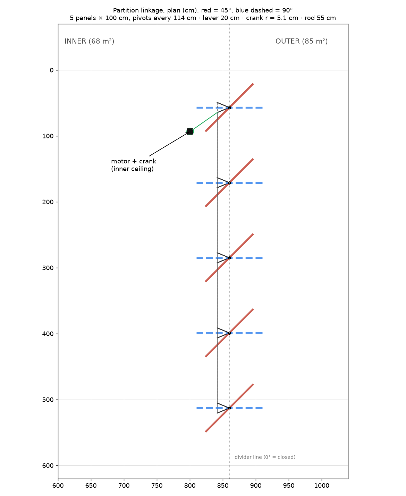

# Partition mechanism (concept)

**Brief (Eily):** partitions between the inner (68 m²) and outer (85 m²) spaces, on the centre line, each 1 m wide, pivoting on
its own centre axis, free to turn 360°. A mechanism moves them all together through 45°, so they are never all closed together.
The motor hangs from the ceiling of the inner room.

## Layout (defaults in `room.json` → `partitions`)
- 5 panels × 100 cm on the divider line, which runs 570 cm from the north wall to the column. That puts the pivots 114 cm apart, so
  the panels clear each other (14 cm) even when they are closed in line, and each panel can still turn a full 360° on its own.
- Panel height = ceiling − 3 cm top − 3 cm bottom.
- Angles are measured from the divider line: 0° = closed (in line with the divider), 90° = fully open (across the divider).

## Linkage
1. **Shafts:** each panel hangs on a vertical shaft at its centre, with a bearing at the top. A floor pin takes side loads only.
2. **Levers:** at the top, each shaft carries a 20 cm lever. It is clamped at 22.5° to the panel, so at mid-swing it points straight into the inner space.
3. **Tie bar:** one tie bar pins all 5 lever tips together. That makes a parallelogram, so every panel always has the same angle. The tie bar stays at least 18.5 cm from the shafts, so it never crosses a pivot.
4. **Motor and crank:** a gear motor hangs from the inner ceiling at plan (800, 93) cm, about 60 cm into the inner space, clear of every panel's swing (70 cm from pivot 1 vs. a 50 cm panel radius). It turns a 5.1 cm crank continuously in one direction.
5. **Connecting rod:** a 55 cm rod links the crank to the first lever. This is a crank-rocker: the rocker's dead points are exactly 45° and 90°. Simulated over a full crank turn, the swing is **45.0°–90.0°**, so the panels can never reach 0° (closed). The limit comes from the geometry itself, not from a switch or software.
6. **Timing:** one crank turn = one open-close-open cycle. The default is 60 s, which needs a ~1 rpm output gear motor.
7. **Free rotation (360°):** each lever is clamped to its shaft with a pin or clamp collar. Remove it, and that panel turns freely by hand.

## Open questions
- Panel material and weight, which set the motor torque and bearing size. 1 m × ~3.4 m × 2 cm plywood ≈ 40 kg per panel. At ~1 rpm the torque needed is mostly bearing friction, but a self-locking worm gear motor (≥ 10 N·m) holds the panels against people pushing them.
- Where the linkage lives. The sim draws it in the 3 cm gap above the panels. In the room it is probably better hidden above the ceiling grid, with the shafts going up through it.
- Swing limits. Eily asked for 45°. The sim lets her change the limits and the cycle time, and the crank geometry is recomputed (`tools/mechanism_diagram.py`).
